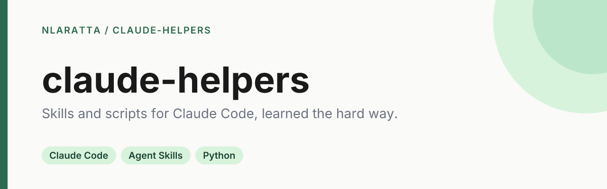

<p align="center">
  
</p>

<p align="center">
  <a href="https://github.com/nlaratta/claude-helpers/actions/workflows/ci.yml"></a>
  <a href="LICENSE"></a>
</p>

A collection of skills, tools, and references for working with Claude Code and the Claude Agent SDK — distilled from things that worked well in practice or were learned the hard way.

## Quick start

```bash
git clone https://github.com/nlaratta/claude-helpers.git
cp -R claude-helpers/skills/claude-code-recovery ~/.claude/skills/
```

Start a new Claude Code session and the skill is available. Claude uses it when you describe lost work, and you can also ask for it by name.

## Contents

### Skills

Drop these into `~/.claude/skills/<skill-name>/` (user-level) or into a plugin's `skills/` directory. Each has a `SKILL.md` that Claude reads to decide when to invoke it.

- **[claude-code-recovery](skills/claude-code-recovery/)** — recover lost work after a Claude Code Desktop worktree is archived, deleted, or otherwise wiped. Reconstructs files by replaying `tool_use` events from the session's JSONL transcripts. Handles the non-obvious failure modes (compacted-session event duplication, split transcripts across migrated working directories, dangling stashes).

## Using a skill

1. Copy the skill directory into `~/.claude/skills/` on your machine.
2. Start a Claude Code session — the skill's description is auto-loaded into context, so Claude will invoke it when a matching task comes up.

See Anthropic's [skill docs](https://docs.claude.com/en/docs/claude-code/skills) for how skills get loaded and triggered.

## Checks

`python tools/check_skills.py` validates every skill's frontmatter and links and runs each script's `--help`. CI runs it on every push.

## Contributing

This repo is a running scratchpad. PRs welcome if something here helped you and you found an edge case worth encoding.

## License

[MIT](LICENSE) © Noah Laratta
